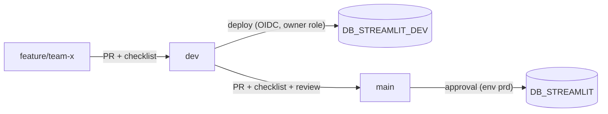

# streamlit-governance-cicd

CI/CD for **Streamlit in Snowflake apps on compute pools** (container runtime) and for **CoCo skills**.
Verisure pilot, tested in a Snowflake test account. Guide in Spanish: [docs/GUIA.md](docs/GUIA.md).

## How it works



| Piece | Where |
| --- | --- |
| Rules (single source of truth) | `skills/streamlit-app-standards/standards.yml` |
| Checklist script (used by the skill **and** by CI) | `skills/streamlit-app-standards/scripts/check_streamlit_app.py` |
| PR gate: checklist + PR comment + skill validation | `.github/workflows/pr-checks.yml` |
| App deploy (team owner role, compute pool, verify) | `.github/workflows/deploy-apps.yml`, `ci/deploy_app.py` |
| Skill deploy (auto RBAC, certification, email) | `.github/workflows/sync-skills.yml`, `ci/sync_skills.py`, `snowflake/skills/` |
| Teams and environments | `config/teams.yml`, `config/envs.yml` |
| Snowflake setup (admin) | `snowflake/install.sh`, `snowflake/onboard_team.sh` |

## Add an app
1. Branch from `dev`: `feature/<team>-<description>`.
2. Create `apps/<team>/<app_name>/` with `streamlit_app.py`, `requirements.txt`, `app.yml` and `README.md`. The `streamlit-app-standards` skill does this for you.
3. Run the checklist locally:
   `python skills/streamlit-app-standards/scripts/check_streamlit_app.py apps/<team>/<app_name> --head-branch <branch> --base-branch dev`
4. Open a PR into `dev`. On merge, the app is deployed to DEV. Then open a PR `dev` → `main`; after approval, it's deployed to PRD.

## Tests
```bash
pip install pyyaml==6.0.2 pytest==8.3.4
python -m pytest ci/tests -q
```
