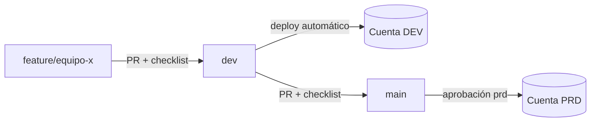

# Guía: CI/CD de apps Streamlit y de skills (piloto Verisure)

Esta guía explica cómo funciona el CI/CD, cómo añadir un equipo y una app, y qué hemos probado.

## 1. Idea general



- Las apps están en una base de datos central `DB_STREAMLIT`, con **un esquema por equipo**.
- El CI/CD despliega **con el rol owner del equipo** (`<EQUIPO>_STREAMLIT_OWNER`). La propiedad de una app
  Streamlit no se puede transferir, por eso no se despliega con otro rol.
- Cada equipo tiene **su compute pool** y usa **su warehouse**, los dos con el tag `TEAM`
  (coste visible por equipo: `snowflake/80_cost_by_team.sql`).
- Las personas que usan las apps tienen el rol `<EQUIPO>_STREAMLIT_USERS` y ven **todas** las apps de su equipo.

## 2. Dos modelos de acceso a los datos

| | Owner's rights (`rights: owner`) | Restricted caller's rights (`rights: caller`) |
| --- | --- | --- |
| Quién lee los datos | El rol owner de la app | El usuario que abre la app |
| Row access policy por usuario | **No** (ve el rol owner) | **Sí** |
| El usuario necesita acceso a los datos | No | Sí (su propio rol) |
| Conexión en el código | `st.connection("snowflake")` | `st.connection("snowflake-callers-rights")` |
| Ejemplo | FinOps, informes centrales | Ventas por país |

Importante para caller's rights:
- Se usa el **rol por defecto** del usuario, no el rol que elige en Snowsight.
- El admin da los "caller grants" al rol owner (`onboard_team.sh ... caller`). Estos grants no dan acceso:
  solo permiten a la app usar el acceso que el usuario ya tiene.

## 3. El checklist (la skill) bloquea el PR

- Las reglas están en `skills/streamlit-app-standards/standards.yml`.
- El mismo script (`scripts/check_streamlit_app.py`) se usa en dos sitios:
  1. En local: la skill `streamlit-app-standards` ayuda al desarrollador en CoCo y ejecuta el checklist.
  2. En GitHub Actions: en cada PR. Si hay un error, **el PR queda bloqueado** y un comentario explica
     qué falla y cómo arreglarlo. El comentario se actualiza en cada push.
- Una skill son instrucciones para el asistente de IA; GitHub no puede "ejecutar" una skill. Por eso
  ponemos el checklist como script dentro de la skill: mismas reglas, mismo resultado en los dos sitios.

## 4. Añadir un equipo (admin, una vez por cuenta)

```bash
cd snowflake
./install.sh <conexion> dev        # una vez por entorno
./onboard_team.sh <conexion> dev FINANCE caller TEST_DATA_FINANCE.GOLD
```
Y añadir el equipo en `config/teams.yml` (carpeta, modelos de acceso permitidos, warehouse).

## 5. Añadir una app (desarrollador)

1. Crear una rama desde `dev`: `feature/<equipo>-<descripcion>`.
2. Crear `apps/<equipo>/<nombre_app>/` con `streamlit_app.py`, `requirements.txt`, `app.yml` y `README.md`
   (la skill lo hace).
3. Ejecutar el checklist en local y abrir el PR a `dev`.
4. Merge → deploy automático a DEV. Después PR `dev` → `main`, merge y **aprobación en el entorno `prd`** → PRD.

## 6. Skills (CI/CD de skills, como en SEAT)

- Push a `dev` → la skill se publica en `DB_COCO_SKILLS.SKILLS_DEV` (oculta, "[DEV]").
- Push a `main` (con aprobación `prd`) → `SKILLS_PRD`, **certificada**, y **email** a los usuarios del rol
  `<SKILL>_SKILL_USERS`.
- El pipeline **crea los roles de cada skill** (`<SKILL>_SKILL_DEV`, `<SKILL>_SKILL_USERS`).
- Solo se publica una versión nueva si los ficheros de la skill cambian.

## 7. Qué hemos probado (cuenta de test)

| Prueba | Resultado |
| --- | --- |
| 44 tests unitarios del checklist (cada regla, caso bueno y malo) | OK |
| Login GitHub → Snowflake con OIDC (sin contraseña ni clave) | OK |
| PR con app mal hecha: 5 errores, PR bloqueado, comentario con la solución | OK |
| Merge forzado por un admin con el check en rojo | Rechazado por GitHub |
| App corregida: comentario en PASSED, PR desbloqueado | OK |
| Deploy a DEV solo de la app cambiada | OK |
| Release a PRD con aprobación en el entorno `prd` | OK |
| Redeploy: misma URL, grants mantenidos | OK |
| Equipo desconocido / entorno desconocido | Rechazado antes de Snowflake |
| Rol de DEV no puede usar roles de PRD | OK |
| Sin caller grants / sin grant al rol USERS | El verify falla con mensaje claro |
| Skill: creada en DEV, roles creados, PRD certificada, email enviado | OK |
| Row access policy por rol (ES ve ES, PT ve PT) | OK |

## 8. Notas para Verisure

- **Runners self-hosted con rol AWS:** cambiar el `WORKLOAD_IDENTITY` del usuario de servicio a `TYPE = AWS`
  con el ARN del rol, y la network policy a las IPs de salida de los runners.
- **Subject de OIDC:** GitHub puede enviar el subject con IDs (`repo:owner@ID/repo@ID:environment:dev`).
  Hay que poner exactamente lo que envía GitHub. Es más seguro (no cambia si se renombra el repo).
- **Runners de GitHub (hosted):** a veces usan una IP que no está en la lista publicada por GitHub y la
  network policy la bloquea. Con runners self-hosted (IPs fijas) no pasa.
- **Aprobación de `prd`:** solo una persona puede aprobar (GitHub no deja aprobar con un token).
- **Compartir una app con otra cuenta (listing):** una app Streamlit no se puede poner en un share; hay que
  empaquetarla como Native App. Los datos pueden quedarse en su base de datos (REFERENCE_USAGE + vista en el paquete).
- **Limpieza de la cuenta de test:** `snowflake/99_teardown.sql` (revisar antes de ejecutar).
